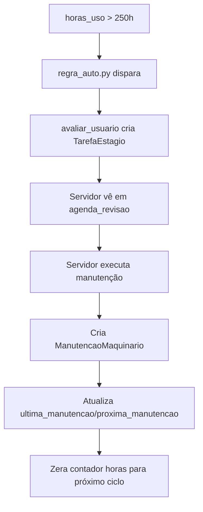

# Modelo Maquinário & Manutenção — Estado 2026-10-11

> Fonte: `app/models/maquinario.py` (96 linhas)

---

## 1. Maquinario (`app/models/maquinario.py:21-71`)

### Tipos
| Código | Descrição |
|-------|-----------|
| `TRATOR` | Trator |
| `COLHEITADEIRA` | Colheitadeira |
| `PULVERIZADOR` | Pulverizador |
| `CAMINHAO` | Caminhão |
| `IMPLEMENTO` | Implemento |
| `PLANTADEIRA` | Plantadeira |
| `DRONE` | Drone |
| `OUTRO` | Outro |

### Campos Principais
| Campo | Tipo | Descrição |
|-------|------|-----------|
| `propriedade` | FK(Propriedade) | CASCADE |
| `tipo` | CharField(20) | Choices TIPOS_MAQUINARIO |
| `nome` | CharField(100) | Nome identificador |
| `marca/modelo` | CharField(100) | |
| `ano_fabricacao` | IntegerField | |
| `horas_uso` | DecimalField(8,1) | Horímetro |
| `ultima_manutencao/proxima_manutencao` | DateField | Controle preventivo |
| `ativo` | BooleanField | Default True |

### Depreciação Linear (`valor_atual` property)
```python
@property
def valor_atual(self):
    """Depreciação linear: valor_aquisicao - desgaste proporcional.
    Nunca abaixo do residual. Ex: 100k, residual 10k, 10 anos, 5 anos uso -> 55k.
    Retorna None se faltar base (valor, vida útil ou data)."""
```
**Fórmula:**
- `total = valor_aquisicao - valor_residual`
- `anos_uso = (hoje - data_aquisicao).days / 365.25`
- `fracao = min(max(anos_uso, 0) / vida_util_anos, 1)`
- `valor_atual = valor_aquisicao - total * fracao`
- **Nunca abaixo de `valor_residual`**

### Campos de Depreciação
| Campo | Tipo | Descrição |
|-------|------|-----------|
| `valor_aquisicao` | DecimalField(12,2) | |
| `valor_residual` | DecimalField(12,2) | Valor residual estimado |
| `vida_util_anos` | IntegerField | Anos de vida útil |
| `data_aquisicao` | DateField | Data da compra |

---

## 2. ManutencaoMaquinario (`app/models/maquinario.py:73-96`)

### Tipos de Manutenção
| Código | Descrição |
|--------|-----------|
| `PREVENTIVA` | Padrão — programada |
| `CORRETIVA` | Quebra não planejada |
| `PREDITIVA` | Baseada em sensores/horímetro |

### Campos
| Campo | Tipo | Descrição |
|-------|------|-----------|
| `maquinario` | FK(Maquinario) | CASCADE |
| `data` | DateField | Default now |
| `tipo` | CharField(30) | PREVENTIVA/CORRETIVA/PREDITIVA |
| `descricao` | TextField | O que foi feito |
| `custo` | DecimalField(10,2) | Default 0 |
| `horimetro` | DecimalField(8,1) | Horímetro na manutenção |
| `pecas` | JSONField | Lista de peças (default `[]`) |
| `responsavel` | CharField(100) | |

---

## 3. Integração com Motor Proativo (`app/ia/regras_auto.py:339`)

**Regra ativa:** `"[ERP] John Deere -30% R$120k/1000ha - horimetro >250h"`

**Fluxo:**
1. `horas_uso` > 250h → regra dispara
2. `avaliar_usuario()` cria `TarefaEstagio` tipo `manutencao`
3. Servidor vê na `agenda_revisao` (`servidor_dashboard_view`)
4. Cria `ManutencaoMaquinario` ao executar

---

## 4. Integração Financeira (LCDPR)

### MovimentacaoBancaria / LancamentoFinanceiro
| Evento | Tipo LCDPR | Categoria |
|--------|------------|-----------|
| Compra maquinário | `DESPESA` / `MANUTENCAO` | `tipo_lancamento_lcdpr=2` |
| Manutenção corretiva | `DESPESA` / `MANUTENCAO` | `tipo_lancamento_lcdpr=2` |
| Venda maquinário | `RECEITA` / `VENDA_PROD` | `tipo_lancamento_lcdpr=1` |

---

## 5. Importador CSV (`importar_csv_maquinario.py`)

**Mapeamento CSV → Maquinario:**
| CSV | Modelo |
|-----|--------|
| `horimetro` | `horas_uso` |
| `data_manutencao` | `ultima_manutencao` |
| `proxima_revisao` | `proxima_manutencao` |

**Ativa regra proativa** (`regras_auto.py:339`) ao importar `horas_uso`.

---

## 6. API Views

| ViewSet | Arquivo | Endpoint |
|---------|---------|----------|
| `MaquinarioViewSet` | `app/api/views/maquinario.py` | `/api/maquinarios/` |
| `ManutencaoMaquinario` | via `app/api/views/faltantes.py` | `/api/manutencao-maquinario/` |

---

## 7. Guardas de Regressão

| Teste | O que impede |
|-------|--------------|
| `tests/test_mecanicas.py` | Depreciação não abaixo do residual |
| `tests/test_importar_csv_maquinario.py` | Import CSV atualiza horímetro e dispara regra proativa |
| `tests/test_revisao_maquinas.py` | Próxima manutenção respeitada |

---

## 8. Fluxo de Manutenção Preventiva



---

## 8. Checklist de Operação

- [ ] `horas_uso` atualizado periodicamente (manual ou CSV)
- [ ] `proxima_manutencao` preenchida → aparece em `agenda_revisao`
- [ ] `ManutencaoMaquinario` registrada com `horimetro` atual
- [ ] `valor_atual` não abaixo de `valor_residual`
- [ ] `pecas` JSON preenchido para histórico de custos